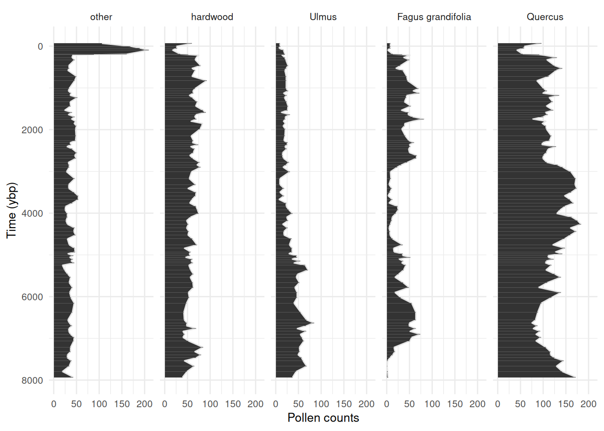
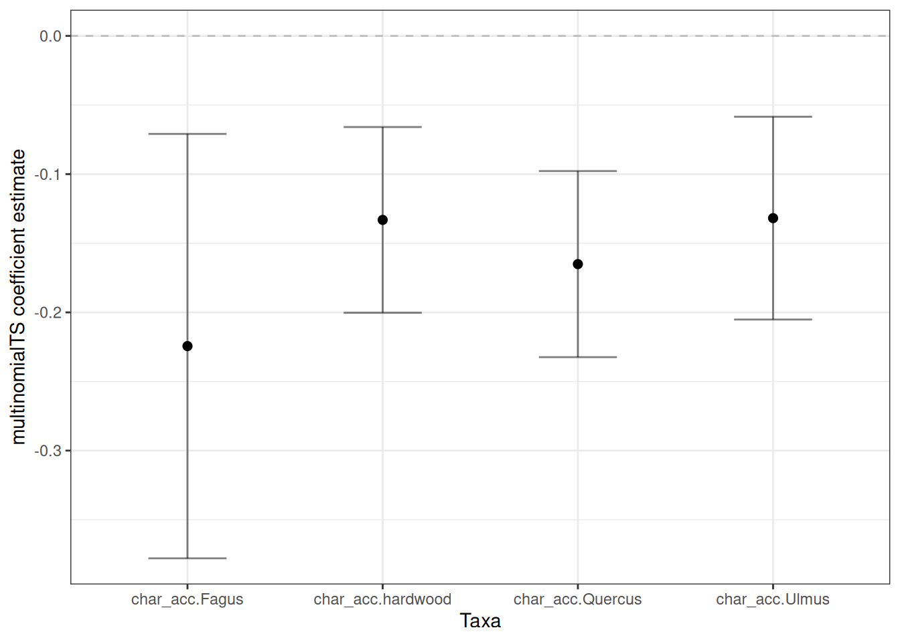
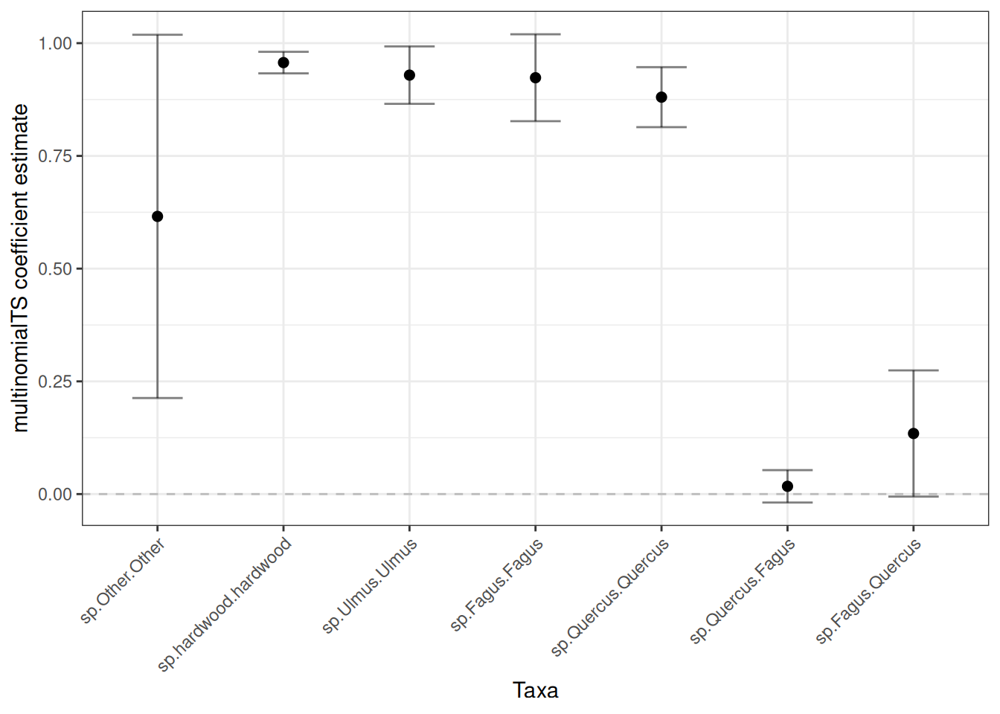

# multinomialTS Vignette

## Introduction

One of the primary goals of this model is to be able to test multiple
hypotheses about the data and lend statistical support to the different
hypotheses. For example which environmental drivers are having the
strongest effects on which taxa? Or, are interactions among taxa or
abiotic variables driving change in the system? This state-space
approach allows us to estimate coefficients for taxa interactions and
driver-taxa relationships, that we don’t get from methods such as
ordination or cluster analysis. We recommend this method as
complementary to other methods, as both have their advantages.

### This vignette

This vignette will take us through:

- Choosing a prediction resolution for
  [`mnTS()`](https://quinnasena.github.io/multinomialTS/reference/mnTS.md)
  ([Section 2](#sec-data)).
- The fitting process ([Section 3](#sec-fitting)).
  - Finding initial conditions with
    [`mnGLMM()`](https://quinnasena.github.io/multinomialTS/reference/mnGLMM.md)
    ([Section 3.1](#sec-glmm)).
  - Fitting
    [`mnTS()`](https://quinnasena.github.io/multinomialTS/reference/mnTS.md)
    with and without species interactions ([Section 3.3](#sec-mnts)).
- Assessing the resulting models ([Section 3.4](#sec-interp)).

## Data processing

This vignette will work with the data that have focal taxa and groups
already wrangled. A second vignette will be added to cover the data
wrangling, for now see [this
workshop](https://quinnasena.github.io/state-space-workhop-ESA/state-space-walkthrough.html)

``` r

# Load required packages
# multinomialTS handles its own dependencies (Rcpp, minqa, numDeriv, ...);
# the packages below are only for the data wrangling and plotting shown here.
library(ggplot2)
library(dplyr)
library(tidyr)
library(stringr)
library(scales)
library(multinomialTS)

# Read-in the wrangled data 
# Read in our X variables
data("story_char_wide", package = "multinomialTS")
# Read-in the long data for plotting
data("story_pollen_wide", package = "multinomialTS")
```

Here is what the state variable ($`Y`$) data look like:

``` r

head(story_pollen_wide)
```

    # A tibble: 6 × 7
         age depth other hardwood `Fagus grandifolia` Quercus Ulmus
       <dbl> <dbl> <int>    <int>               <int>   <int> <int>
    1 -66.2    0.5   106       60                   8      96     9
    2   2.85  32.5   169       26                   8      59    10
    3  45.8   64.5   189       27                   8      58     7
    4  94.1   96.5   209       17                   2      42    17
    5 191.   128.    161       34                  13      55    20
    6 203.   132.     88       52                  34      91    19

And our covariate ($`X`$):

``` r

head(story_char_wide)
```

    # A tibble: 6 × 3
        age depth char_acc
      <dbl> <dbl>    <dbl>
    1 -66.2   0.5      0
    2 -63.4   1.5     15.8
    3 -61.4   2.5     40.3
    4 -59.8   3.5     21.8
    5 -58.5   4.5     37.3
    6 -57.2   5.5     29.8

For the moment, we are keeping the age and depth columns in both
tibbles. These columns are so that we have a common variable to match
the two tibbles, and will be removed a little later.

Always check out some plots! See that big spike in “other”, this is the
rise of ambrosia in recent decades. Worth clipping that from the data,
major trends in the out-group indicates that something important is
being aggregated in the reference (we don’t want that). I have left it
in this example dataset for demonstration purposes.

Code

``` r

story_pollen_wide |>
  pivot_longer(-c(age, depth)) |>
  mutate(name = factor(name,levels = c(
    "other", "hardwood", "Ulmus", "Fagus grandifolia", "Quercus"))) |>
  ggplot(aes(x = age, y = value)) +
    geom_area(colour = "grey90") +
    geom_col() +
    scale_x_reverse(breaks = scales::breaks_pretty(n = 6)) +
    coord_flip() +
    labs(y = "Pollen counts", x = "Time (ybp)") +
    facet_wrap(~name,
               nrow = 1) +
    theme_minimal() +
    theme(
      text = element_text(size = 10)
    )
```



### State variables $`Y`$

We will start off by choosing a resolution for the model predictions
(*e.g.,* predicting ecological process at 50 or 100 year intervals).

``` r

# Time-span of the data divided by the number of observations
max(story_pollen_wide$age) / nrow(story_pollen_wide)
```

    [1] 83.48578

``` r

# Age differences between successive observations
diff(story_pollen_wide$age)
```

     [1]  69.017  42.946  48.331  96.968  11.459  14.340  54.308  55.284 138.681
    [10]  66.118  48.695 143.230 103.015 186.753  58.537  54.550  52.888  50.954
    [19] 104.623 100.248 100.144  51.406  53.372  52.350  53.950  51.957  53.782
    [28]  59.512  72.266 168.719 111.125  47.302  47.531  47.949  55.391  90.190
    [37]  66.359  68.199  97.921  60.144  54.207 109.400 165.792 141.147  93.284
    [46]  90.969  85.959  87.634  86.346  79.080  85.733  84.658  85.647  85.731
    [55]  86.000  88.257  84.158  86.849  90.252 144.587  79.708  89.321  43.635
    [64]  43.511  42.991  42.250  44.523  47.083  54.088 115.201  99.857  73.484
    [73] 128.326 116.359 119.324 123.707 132.304 219.725 184.122  71.101  68.843
    [82]  66.205  65.555  71.999  71.922  86.020 153.328 103.854  76.139  71.061
    [91]  71.132 129.632 127.729 137.070

``` r

# The range of the age differences
range(diff(story_pollen_wide$age))
```

    [1]  11.459 219.725

``` r

# the average of the age differences
mean(diff(story_pollen_wide$age))
```

    [1] 85.0778

``` r

sd(diff(story_pollen_wide$age))
```

    [1] 38.36777

This all looks great! If we bin the data at around 50-75 years, we will
still have most of our data in independent bins.

Now that we know roughly what bin-width to use to maximize the number of
observations in the state variables, we will apply the same bin-width to
both the state variables and the covariate data.

### Handling the covariates $`X`$

Covariates need to be handled according to decisions that were made
around the state variables, that is, if the state variables were binned
at a century-level resolution then the covariates must match that
resolution. We *can* have a finer temporal resolution of the covariates
than we do of the state variables. In this dataset, our state variables
have 95 observations, and our covariate has 646 observations over the
same time-span. Having more observations of environmental covariates is
common in palaeo-data and works well with fitting the model.

Since we need to apply the same binning procedure to both the state
variables and the covariate, I like to join both datasets. Charcoal was
sampled to a greater depth than the pollen data, so we are going to clip
the covariate to the extent of the state variables and join the two
datasets by their common variable, age.

``` r

# Clip covariate data to the extent of the state variables
# Join the two by age so that we get a square matrix
story_join <- story_char_wide |>
  dplyr::filter(age <= max(story_pollen_wide$age)) |>
  left_join(story_pollen_wide, by = c("age", "depth"))

# Always double check dimensions before/after joining!
# dim(story_join)
# tail(story_join)
```

Now we have all our data joined. Note that the covariate $`X`$
(`char_acc`) has observations every cm, whereas pollen was sampled at
less frequent intervals (this is OK!).

``` r

head(story_join, n = 10)
```

    # A tibble: 10 × 8
         age depth char_acc other hardwood `Fagus grandifolia` Quercus Ulmus
       <dbl> <dbl>    <dbl> <int>    <int>               <int>   <int> <int>
     1 -66.2   0.5     0      106       60                   8      96     9
     2 -63.4   1.5    15.8     NA       NA                  NA      NA    NA
     3 -61.4   2.5    40.3     NA       NA                  NA      NA    NA
     4 -59.8   3.5    21.8     NA       NA                  NA      NA    NA
     5 -58.5   4.5    37.3     NA       NA                  NA      NA    NA
     6 -57.2   5.5    29.8     NA       NA                  NA      NA    NA
     7 -56.0   6.5    34.4     NA       NA                  NA      NA    NA
     8 -54.8   7.5    21.2     NA       NA                  NA      NA    NA
     9 -53.7   8.5    20.5     NA       NA                  NA      NA    NA
    10 -52.6   9.5     8.26    NA       NA                  NA      NA    NA

I always do lots of quick checks like
[`head()`](https://rdrr.io/r/utils/head.html),
[`tail()`](https://rdrr.io/r/utils/head.html),
[`dim()`](https://rdrr.io/r/base/dim.html) (and many more!) to make sure
to catch any coding mistakes!

``` r

tail(story_join, n = 10)
```

    # A tibble: 10 × 8
         age depth char_acc other hardwood `Fagus grandifolia` Quercus Ulmus
       <dbl> <dbl>    <dbl> <int>    <int>               <int>   <int> <int>
     1 7777.  648.     2.50    NA       NA                  NA      NA    NA
     2 7794.  648.     8.19    19       49                   2     142    45
     3 7812.  650.    19.1     NA       NA                  NA      NA    NA
     4 7829.  650.     6.19    NA       NA                  NA      NA    NA
     5 7845.  652.     2.78    NA       NA                  NA      NA    NA
     6 7863.  652.     4.20    NA       NA                  NA      NA    NA
     7 7880.  654.     5.02    NA       NA                  NA      NA    NA
     8 7898.  654.     3.17    NA       NA                  NA      NA    NA
     9 7914.  656.     4.51    NA       NA                  NA      NA    NA
    10 7931.  656.     2.60    43       39                   3     172    37

This all looks good, and we can now bin the data to an appropriate
temporal resolution for fitting the model. Choosing a bin-width may take
some trial and error, I’m going with a bin-width of 50 years.

``` r

# This code chunks the data into bins and gives us a grouping variable "bins"

bin_width <- 50
bins <- cut(story_join$age,
            breaks = seq(from = min(story_join$age),
            to = max(story_join$age) + bin_width,
            by = bin_width), include.lowest = TRUE, labels = FALSE)
```

We now apply the bins to our data. For most types of covariates we want
the *average* value of the covariate in each bin. But for the pollen
count data, we want the *sum*. This is because of the underlying
multinomial distribution in the model.

``` r

# Assign bin indices, then summarise: mean age and charcoal per bin; sum pollen counts per bin
story_binned <- bind_cols(bins = bins, story_join) |>
  group_by(bins) |>
  summarise(
    age = mean(age, na.rm = TRUE), # the center of the bin
    char_acc = mean(char_acc, na.rm = TRUE), # mean charcoal accumulation rate per bin
    other = sum(other, na.rm = TRUE), # the sums of the count data
    hardwood = sum(hardwood, na.rm = TRUE),
    `Fagus grandifolia` = sum(`Fagus grandifolia`, na.rm = TRUE),
    Ulmus = sum(Ulmus, na.rm = TRUE),
    Quercus = sum(Quercus, na.rm = TRUE)
  ) |>
  arrange(desc(age))
# Be aware that the gaps in the pollen data are now filled with 0's not NA
```

> **This is important**
>
> We want the model to run from the past to the present, and the model
> runs from the top of the matrix to the bottom. So we want to make sure
> that the top row of the data is the *oldest* date. Palaeo-data are
> usually ordered from the top of the core to the bottom (present to
> past), so we `arrange(desc(age))`.

Let’s see what the data look like binned at a 50 year resolution:

``` r

head(story_binned, n = 10)
```

    # A tibble: 10 × 8
        bins   age char_acc other hardwood `Fagus grandifolia` Ulmus Quercus
       <int> <dbl>    <dbl> <int>    <int>               <int> <int>   <int>
     1   160 7914.     3.43    43       39                   3    37     172
     2   159 7863.     4.00     0        0                   0     0       0
     3   158 7812.    11.1     19       49                   2    45     142
     4   157 7761.     4.06     0        0                   0     0       0
     5   156 7713.     5.29     0        0                   0     0       0
     6   155 7666.     8.24    34       65                   1    68     129
     7   154 7609.     8.50     0        0                   0     0       0
     8   153 7553.     9.27    39       43                   2    60     145
     9   152 7502.     5.05     0        0                   0     0       0
    10   151 7457.     5.46    30       69                   7    57     125

This is looking good, we have reduced the time-intervals over which to
iterate the model. The data are now 160 rows with complete covariate
data, containing 93 state variable observations. The original number of
pollen observations was 95, so we have not summed many observations
within the same bins.

`multinomialTS` requires two matrices, a site-by-species matrix $`Y`$,
and a covariate matrix $`X`$, so we will leave `tibbles` behind and
split the data. $`X`$ variables may be of different types (e.g.,
continuous, categorical…) but should be scaled relative to each other.

``` r

story_pollen_matrix <- story_binned |>  # Select taxa
  select(other, hardwood, Ulmus, `Fagus grandifolia`, Quercus) |> 
  rename("Fagus" = "Fagus grandifolia") |> 
  as.matrix()
# Replacing 0 with NA is not strictly necessary the way we use the data today
# But it is a good safety to avoid 0-count data where it should be no observation
story_pollen_matrix[which(rowSums(story_pollen_matrix) == 0), ] <- NA
head(story_pollen_matrix)
```

         other hardwood Ulmus Fagus Quercus
    [1,]    43       39    37     3     172
    [2,]    NA       NA    NA    NA      NA
    [3,]    19       49    45     2     142
    [4,]    NA       NA    NA    NA      NA
    [5,]    NA       NA    NA    NA      NA
    [6,]    34       65    68     1     129

``` r

story_char_matrix_scaled <- story_binned |> # select covariates
  select(char_acc) |> 
  as.matrix() |> 
  scale() # Scale covariates
head(story_char_matrix_scaled)
```

           char_acc
    [1,] -0.9826414
    [2,] -0.8978991
    [3,]  0.1548837
    [4,] -0.8894600
    [5,] -0.7078643
    [6,] -0.2731469

## Fitting `multinomialTS`

OK, now we have:

- Chosen a temporal resolution for the model of 50-year bins
- Organised the data into a site-by-species matrix $`Y`$ at 50-year bins
- Binned and scaled covariate matrix $`X`$

With that, we can fit the model.

### Finding initial conditions using `mnGLMM()`

The
[`mnTS()`](https://quinnasena.github.io/multinomialTS/reference/mnTS.md)
function will provide estimates for biotic interactions ($`C`$ matrix),
taxa-driver relationships ($`B`$ matrix), and cross-correlated error
($`V`$ matrix). But the model needs initial starting values for these
parameters to begin with. We get initial starting conditions from the
data by running the
[`mnGLMM()`](https://quinnasena.github.io/multinomialTS/reference/mnGLMM.md)
function.
[`mnGLMM()`](https://quinnasena.github.io/multinomialTS/reference/mnGLMM.md)
returns estimates for the $`B`$ and $`V`$ matrices (not the $`C`$
matrix) and assumes that there are no time gaps in the data.

> **Tip**
>
> The arguments of the *starting* values in both the
> [`mnGLMM()`](https://quinnasena.github.io/multinomialTS/reference/mnGLMM.md)
> and
> [`mnTS()`](https://quinnasena.github.io/multinomialTS/reference/mnTS.md)
> are all suffixed with `.start` (e.g., `B.start` will be the starting
> values for the $`B`$ matrix).
>
> The arguments of the parameters to be *estimated* are all suffixed
> with `.fixed` (e.g., `B.fixed` will be parameters that are estimated
> from $`B`$ matrix).

#### Setting-up parameters for `mnGLMM()`

Now, lets set up the parameters for
[`mnGLMM()`](https://quinnasena.github.io/multinomialTS/reference/mnGLMM.md).
We need:

- A vector that indicates the row indices where there are state variable
  observations: `sample_idx`
- An integer number of covariates (+ 1 for
  [`mnGLMM()`](https://quinnasena.github.io/multinomialTS/reference/mnGLMM.md)):
  `p`
- An integer of the number of state variables: `n`
- A matrix of starting values for $`B`$: `B.start.glmm`
- A matrix of $`B`$ parameters to estimate: `B.fixed.glmm`
- A matrix of $`V`$ parameters to estimate: `V.fixed.glmm`

``` r

# Row indices of non-empty time bins (bins containing at least one pollen observation)
sample_idx <- which(rowSums(story_pollen_matrix) != 0)
# Verify: all rows should have non-zero counts
head(story_pollen_matrix[sample_idx, ])
```

         other hardwood Ulmus Fagus Quercus
    [1,]    43       39    37     3     172
    [2,]    19       49    45     2     142
    [3,]    34       65    68     1     129
    [4,]    39       43    60     2     145
    [5,]    30       69    57     7     125
    [6,]    30       80    49    13     116

Set-up the remaining parameters:

``` r

# p = number of covariates + intercept; n = number of taxa
p <- ncol(story_char_matrix_scaled) + 1
n <- ncol(story_pollen_matrix)
# Estimate all diagonal variances; fix reference taxon variance (V[1,1]) to 1 for identifiability
V.fixed.glmm <- diag(n)
diag(V.fixed.glmm) <- NA
V.fixed.glmm[1] <- 1
# Fix reference taxon (column 1) coefficients to 0; estimate all others (NA = estimate)
B.fixed.glmm <- matrix(c(rep(0,p),rep(NA, (n - 1) * p)), p, n)
B.start.glmm <- matrix(c(rep(0,p),rep(.01, (n - 1) * p)), p, n)
```

These parameters are used as arguments to the
[`mnGLMM()`](https://quinnasena.github.io/multinomialTS/reference/mnGLMM.md)
function. Check them out by printing them in your console. Each matrix
needs to be the correct dimensions given the number of taxa and number
of covariates. The position elements of each matrix reflect the species
and/or the covariates, as we will see later in the output of the model.

#### Fitting `mnGLMM()`

Remember that
[`mnGLMM()`](https://quinnasena.github.io/multinomialTS/reference/mnGLMM.md)
does not handle gaps in the data and only fits complete $`X`$ and $`Y`$
matrices. We have created a variable for our observation indices
(`sample_idx`), so for
[`mnGLMM()`](https://quinnasena.github.io/multinomialTS/reference/mnGLMM.md)
we will index the matrices by this variable: e.g.,
`story_pollen_matrix[sample_idx, ]`.

``` r

# fit glmm
start_time <- Sys.time()
glmm_mod <- mnGLMM(Y = story_pollen_matrix[sample_idx, ],
                   X = story_char_matrix_scaled[sample_idx, , drop = FALSE],
                   B.start = B.start.glmm,
                   B.fixed = B.fixed.glmm,
                   V.fixed = V.fixed.glmm)
end_time <- Sys.time()
```

I like to keep track of how long the models take to run. This will vary
depending on the data set and the system hardware, but can be useful
benchmarking for running models repeatedly. Note the time increase as we
progress from
[`mnGLMM()`](https://quinnasena.github.io/multinomialTS/reference/mnGLMM.md)
to
[`mnTS()`](https://quinnasena.github.io/multinomialTS/reference/mnTS.md)
without, and then with interactions.

``` r

end_time - start_time
```

    Time difference of 1.101739 secs

The outputs of
[`mnGLMM()`](https://quinnasena.github.io/multinomialTS/reference/mnGLMM.md)
can be examined with the `summary(glmm_mod)` function.

``` r

summary(glmm_mod)
```


    Call: mnGLMM with Tmax =  93  n =  5

    logLik = 506.1927,  AIC = -986.3855 [df = 13]

    dispersion parameter =  1

    Fitted Coefficients with approximate se
                               Coef.         se          t            P
    (intercept).hardwood  0.32520822 0.08449718  3.8487465 1.187238e-04
    char_acc.hardwood    -0.15611448 0.08828453 -1.7683106 7.700899e-02
    (intercept).Ulmus    -0.31412625 0.11063698 -2.8392518 4.521945e-03
    char_acc.Ulmus       -0.27877593 0.10904241 -2.5565827 1.057059e-02
    (intercept).Fagus    -0.26462962 0.11061637 -2.3923188 1.674229e-02
    char_acc.Fagus       -0.44518066 0.11465595 -3.8827524 1.032807e-04
    (intercept).Quercus   0.99820847 0.08800697 11.3423798 8.091369e-30
    char_acc.Quercus     -0.06223354 0.09098390 -0.6840061 4.939713e-01


    Overall model

    B =
         [,1]       [,2]       [,3]       [,4]        [,5]
    [1,]    0  0.3252082 -0.3141263 -0.2646296  0.99820847
    [2,]    0 -0.1561145 -0.2787759 -0.4451807 -0.06223354

    sigma =  1.055386

    V =
         [,1]        [,2]      [,3]      [,4]       [,5]
    [1,]    1 0.000000000 0.0000000 0.0000000 0.00000000
    [2,]    0 0.004430663 0.0000000 0.0000000 0.00000000
    [3,]    0 0.000000000 0.3021316 0.0000000 0.00000000
    [4,]    0 0.000000000 0.0000000 0.3045216 0.00000000
    [5,]    0 0.000000000 0.0000000 0.0000000 0.07575798

### Setting-up parameters for `mnTS()`

Now, lets set up the parameters for
[`mnTS()`](https://quinnasena.github.io/multinomialTS/reference/mnTS.md).
[`mnTS()`](https://quinnasena.github.io/multinomialTS/reference/mnTS.md)
needs:

- row indices as before: `sample_idx`
- the number of covariates: `p`
- the number of state variables: `n`
- starting values for each matrix:
  - $`B0`$: `B0.start.mnTS` (intercept)
  - $`B`$: `B.start.mnTS` (driver-taxa)
  - $`C`$: `C.start.mnTS` (taxa interactions)
  - $`V`$: `V.start.mnTS` (cross-correlated error)
- parameters to estimate for each matrix:
  - $`B0`$: `B0.fixed.mnTS`
  - $`B`$: `B.fixed.mnTS`
  - $`C`$: `C.fixed.mnTS`
  - $`V`$: `V.fixed.mnTS`

We are using the output from
[`mnGLMM()`](https://quinnasena.github.io/multinomialTS/reference/mnGLMM.md)
as starting values for the matrices $`B0`$, $`B`$, and $`V`$.
[`mnGLMM()`](https://quinnasena.github.io/multinomialTS/reference/mnGLMM.md)
does not provide estimates for $`C`$, so we handle $`C`$ a little
differently and we input values close to zero for each parameter
estimated and let
[`mnTS()`](https://quinnasena.github.io/multinomialTS/reference/mnTS.md)
do the rest.

``` r

# Use GLMM estimates as starting values for mnTS: row 1 = intercepts, row 2 = covariate slopes
B0.start.mnTS <- glmm_mod$B[1, , drop = FALSE]
B.start.mnTS <- glmm_mod$B[2, , drop = FALSE]

# Allow all V elements to be estimated; fix reference taxon variance V[1,1] to 1 for identifiability
V.fixed.mnTS <- matrix(NA, n, n)
V.fixed.mnTS[1] <- 1

V.start.mnTS <- glmm_mod$V  # initialise V from GLMM estimate

# Fix reference taxon (column 1) B coefficients to 0; fix reference taxon intercept to 0
B.fixed.mnTS <- matrix(NA, p-1, n)
B.fixed.mnTS[,1] <- 0
B0.fixed.mnTS = matrix(c(0, rep(NA, n - 1)), nrow = 1, ncol = n)

# Diagonal-only C matrix: self-regulation terms only, no between-taxon interactions
# NA = estimate; 0 (off-diagonals) = fixed at zero
C.start.mnTS  <- .5 * diag(n)
C.fixed.mnTS <- C.start.mnTS
C.fixed.mnTS[C.fixed.mnTS != 0] <- NA
```

### Fitting `mnTS()`

Remember,
[`mnTS()`](https://quinnasena.github.io/multinomialTS/reference/mnTS.md)
*does* handle gaps in the state-variables where there are data in the
covariate matrix. In the following code, we use the complete (no gaps)
$`Y`$ matrix `story_pollen_matrix[sample_idx, ]` with dimensions: 93, 5.
And the full $`X`$ matrix: `story_char_matrix_scaled` with dimensions:
160, 1. We will fit the model twice:

- Without taxa interactions.
- With taxa interactions.

> **Tip**
>
> Note the use of sample_idx in `story_pollen_matrix[sample_idx, ]` and
> `Tsample = sample_idx`. This is important as it tells the model where
> there are observations of $`Y`$ in relation to observations in $`X`$.

``` r

start_time <- Sys.time()
mnTS_mod <- mnTS(Y = story_pollen_matrix[sample_idx, ],
                 X = story_char_matrix_scaled, Tsample = sample_idx,
                 B0.start = B0.start.mnTS, B0.fixed = B0.fixed.mnTS,
                 B.start = B.start.mnTS, B.fixed = B.fixed.mnTS,
                 C.start = C.start.mnTS, C.fixed = C.fixed.mnTS,
                 V.start = V.start.mnTS, V.fixed = V.fixed.mnTS,
                 dispersion.fixed = 1, maxit.optim = 1e+6)
# maxit.optim is the max number of iterations the optimiser will complete before stopping.
# increase maxit.optim if the model needs a lot of time to fit.
end_time <- Sys.time()
end_time - start_time
```

    Time difference of 1.244556 mins

In this following code we set-up $`C`$ to define which interactions to
estimate. Here we set-up a two-way interaction between key species.
$`C`$ is not restricted to being symmetrical matrix, i.e., you can
choose to have a one-way interaction effect.

> **Tip**
>
> Note that for the starting values of parameters I am using the output
> of the no-interaction
> [`mnTS()`](https://quinnasena.github.io/multinomialTS/reference/mnTS.md)
> model above. This is perfectly OK because we are only providing
> reasonable starting values for the model to work with. If the starting
> values are closer to the ‘true’ values then the model will likely
> optimize faster.

``` r

# C matrix with two-way interactions between Quercus (row/col 5) and Fagus (row/col 4)
# Off-diagonal elements [5,4] and [4,5] are initialised near zero and freed for estimation
C.start.int.mnTS  <- .5 * diag(n)
C.start.int.mnTS[5, 4] <- .001  # Fagus effect on Quercus
C.start.int.mnTS[4, 5] <- .001  # Quercus effect on Fagus
C.fixed.int.mnTS <- C.start.int.mnTS
C.fixed.int.mnTS[C.fixed.int.mnTS != 0] <- NA  # NA = estimate

start_time <- Sys.time()
mnTS_mod_int <- mnTS(Y = story_pollen_matrix[sample_idx, ],
                     X = story_char_matrix_scaled, Tsample = sample_idx,
                     B0.start = mnTS_mod$B0, B0.fixed = B0.fixed.mnTS,
                     B.start = mnTS_mod$B, B.fixed = B.fixed.mnTS,
                     C.start = mnTS_mod$C, C.fixed = C.fixed.int.mnTS,
                     V.start = mnTS_mod$V, V.fixed = V.fixed.mnTS,
                     dispersion.fixed = 1, maxit.optim = 1e+6)
end_time <- Sys.time() 
end_time - start_time
```

    Time difference of 2.890067 mins

### Interpreting outputs

The [`coef()`](https://rdrr.io/r/stats/coef.html) and
[`summary()`](https://rdrr.io/r/base/summary.html) functions will show
the model outputs. The
[`summary()`](https://rdrr.io/r/base/summary.html) function provides
more information including the fitted coefficients in their matrix
positions. The [`coef()`](https://rdrr.io/r/stats/coef.html) function
provides a single table output of the Wald approximation of the standard
errors. During the model development, we found that the most accurate
(lowest type-I error) method of estimating standard errors was to use
bootstrapping. So, we recommend using the model summaries only as a
preliminary guide for the standard error estimates, and using
bootstrapping to obtain the standard errors (the point estimates
(`Coef.`) will be comparable after bootstrapping). Bootstrapping also
sorts out those `NaN` values that occasionally occur! Let’s check out
the coefficients of interaction model:

``` r

summary(mnTS_mod_int)
```


    Call: mnTS with Tmax =  93  n =  5

    logLik = 750.2299,  AIC = -1440.46 [df = 30]

    dispersion parameter =  1

    Fitted Coefficients with approximate se
                               Coef.         se         t             P
    hardwood              0.64745816        NaN       NaN           NaN
    Ulmus                -0.32223099        NaN       NaN           NaN
    Fagus                -0.96663835 0.17636408 -5.480925  4.231072e-08
    Quercus               1.39240115        NaN       NaN           NaN
    sp.other.other        0.89395402 0.01010232 88.489977  0.000000e+00
    sp.hardwood.hardwood  0.96119715 0.01126113 85.355331  0.000000e+00
    sp.Ulmus.Ulmus        0.94576957 0.01275665 74.139323  0.000000e+00
    sp.Fagus.Fagus        0.83477506 0.03425086 24.372380 3.357730e-131
    sp.Quercus.Fagus      0.06979209        NaN       NaN           NaN
    sp.Fagus.Quercus     -0.08582794        NaN       NaN           NaN
    sp.Quercus.Quercus    0.99248492        NaN       NaN           NaN
    char_acc.hardwood    -0.15798463 0.01939055 -8.147507  3.715044e-16
    char_acc.Ulmus       -0.15969781 0.03647800 -4.377922  1.198164e-05
    char_acc.Fagus       -0.21876440        NaN       NaN           NaN
    char_acc.Quercus     -0.18645951 0.02086948 -8.934553  4.088285e-19


    Overall model

    B0 =
                other  hardwood     Ulmus      Fagus  Quercus
    (intercept)     0 0.6474582 -0.322231 -0.9666384 1.392401


    B =
             other   hardwood      Ulmus      Fagus    Quercus
    char_acc     0 -0.1579846 -0.1596978 -0.2187644 -0.1864595


    C =
                other  hardwood     Ulmus      Fagus     Quercus
    other    0.893954 0.0000000 0.0000000 0.00000000  0.00000000
    hardwood 0.000000 0.9611971 0.0000000 0.00000000  0.00000000
    Ulmus    0.000000 0.0000000 0.9457696 0.00000000  0.00000000
    Fagus    0.000000 0.0000000 0.0000000 0.83477506 -0.08582794
    Quercus  0.000000 0.0000000 0.0000000 0.06979209  0.99248492

    sigma =  0.6557615

    V =
                 other   hardwood      Ulmus      Fagus    Quercus
    other    1.0000000 0.25289482 0.24561961 0.42132929 0.13692874
    hardwood 0.2528948 0.07514634 0.06024390 0.11026409 0.03353239
    Ulmus    0.2456196 0.06024390 0.09596822 0.10852340 0.03038602
    Fagus    0.4213293 0.11026409 0.10852340 0.32153587 0.02417582
    Quercus  0.1369287 0.03353239 0.03038602 0.02417582 0.02668429

``` r

coef(mnTS_mod_int)
```

                               Coef.         se         t             P
    hardwood              0.64745816        NaN       NaN           NaN
    Ulmus                -0.32223099        NaN       NaN           NaN
    Fagus                -0.96663835 0.17636408 -5.480925  4.231072e-08
    Quercus               1.39240115        NaN       NaN           NaN
    sp.other.other        0.89395402 0.01010232 88.489977  0.000000e+00
    sp.hardwood.hardwood  0.96119715 0.01126113 85.355331  0.000000e+00
    sp.Ulmus.Ulmus        0.94576957 0.01275665 74.139323  0.000000e+00
    sp.Fagus.Fagus        0.83477506 0.03425086 24.372380 3.357730e-131
    sp.Quercus.Fagus      0.06979209        NaN       NaN           NaN
    sp.Fagus.Quercus     -0.08582794        NaN       NaN           NaN
    sp.Quercus.Quercus    0.99248492        NaN       NaN           NaN
    char_acc.hardwood    -0.15798463 0.01939055 -8.147507  3.715044e-16
    char_acc.Ulmus       -0.15969781 0.03647800 -4.377922  1.198164e-05
    char_acc.Fagus       -0.21876440        NaN       NaN           NaN
    char_acc.Quercus     -0.18645951 0.02086948 -8.934553  4.088285e-19

### Bootstrapping

We have found that bootstrapping provides better estimates of standard
errors (and subsequent P-values). The
[`bootstrap()`](https://quinnasena.github.io/multinomialTS/reference/bootstrap.md)
function will bootstrap the model, caution as this may take a long time.
To bootstrap a mnTS model you can call:

``` r

# Not run as this takes a long time!
mnTS_int_boot <- bootstrap(mnTS_mod_int, reps = 1000)
```

> **Note**
>
> This function used to be called
> [`boot()`](https://quinnasena.github.io/multinomialTS/reference/boot.md).
> It was renamed because `boot` clashes with
> [`boot::boot()`](https://rdrr.io/pkg/boot/man/boot.html) from the
> `boot` package, which ships with every R installation.
> [`boot()`](https://quinnasena.github.io/multinomialTS/reference/boot.md)
> still works but warns, and will be removed in a future release.

We strongly recommend bootstrapping your final models. Bootstrapping a
model can take quite some time (depending on the data), so don’t be
surprised if it runs for a while! The object returned from bootstrapping
is a `list` with three elements:

1.  `coef.table.boot`: a table with summarised bootstrapped
    coefficients, including the mean and standard deviation, across all
    bootstraps.
2.  `all_mods_pars`: the individual coefficients for all models, where
    each row is one model iteration of the bootstrapping, and each
    column is a coefficient or other model output. This is useful if you
    wish to calculate other metrics such as the median and quartiles of
    the bootstraps.
3.  `all_mods`: a large list containing all the fitted models in their
    original form.

We can do a timing test on 5 bootstraps:

``` r

start_boot <- Sys.time()
mnTS_int_boot <- bootstrap(mnTS_mod_int, reps = 5)
end_boot <- Sys.time()
```

On the system that created this vignette: fitting the initial
interaction model for Story Lake took 2.89 minutes; 5 replicate
bootstraps took 5.59 minutes. The timing will depend greatly on the data
being fit and the system you are running. To speed things up, it can be
useful to process the bootstraps in parallel, check out the [Sunfish
Pond
example](https://quinnasena.github.io/multinomialTS/articles/sunfish_pond_example.md)
for some code on running in parallel and recalculating the coefficients
and standard errors.

#### Plotting bootstrapped coefficients

This section shows how to get at the bootstrapped coefficients and plot
them, using the `coef.table.boot` element of the 5-replicate run above.

> **Important**
>
> Five replicates is **far** too few to interpret. The plots below exist
> to show you the wrangling and plotting code, not to support any
> conclusion — with this few replicates the error bars are essentially
> noise. For real work use as many replicates as your processing power
> allows (hundreds to thousands), and see the timing advice above for
> how to budget that.

Bootstrapping simulates species from the process equation. The simulated
species are named y1 … yn. In future versions I will update the
bootstrapping function to have the option of maintaining the species
names from the input matrix. But for now, we rename them:

> **Warning**
>
> The `y1 ... yn` names map to columns of $`Y`$**by position**, so the
> mapping below is specific to the column order we built above (`other`,
> `hardwood`, `Ulmus`, `Fagus`, `Quercus`). Note that the packaged
> `story_pollen_matrix` dataset has `Ulmus` and `Fagus grandifolia` the
> other way round — always take the mapping from
> [`colnames()`](https://rdrr.io/r/base/colnames.html) of the matrix you
> actually fitted, or the coefficients will be attributed to the wrong
> taxa.

``` r

# Extract and reshape the summarised coefficient table from the bootstrap output
plot_boot <- mnTS_int_boot$coef.table.boot |>
  dplyr::as_tibble(rownames = "name") |>
  dplyr::filter(grepl("sp.*|char.*", name)) |> # Take species and covariate coefficients
  mutate(name = 
           str_replace_all(
             name,
             pattern = "y1|y2|y3|y4|y5|y6",
             replacement = function(x) case_when(
             x == "y1" ~ "Other",
             x == "y2" ~ "hardwood",
             x == "y3" ~ "Ulmus",
             x == "y4" ~ "Fagus",
             x == "y5" ~ "Quercus",
             TRUE ~ x)))
```

I’m going to separate the plots into covariate coefficients and species
coefficients. Let’s take the covariates first:

``` r

plot_cov <- plot_boot |> 
  dplyr::filter(grepl("char.*", name))
  
  
ggplot(plot_cov, aes(x = name, y = boot_mean)) +
  geom_point(size = 2) +
  geom_hline(yintercept = 0, linetype = "dashed", alpha = 0.2) +
  geom_errorbar(aes(ymin = lower68, ymax = upper68),
                    width = .4, alpha = 0.5) +
  labs(x = "Taxa", y = "multinomialTS coefficient estimate") +
  theme_bw() 
```



Now let’s grab the species coefficients:

``` r

plot_spp <- plot_boot |> 
  dplyr::filter(grepl("sp.*", name)) |>  mutate(name = factor(name,
    levels = c(
      "sp.Other.Other",
      "sp.hardwood.hardwood",
      "sp.Ulmus.Ulmus",
      "sp.Fagus.Fagus",
      "sp.Quercus.Quercus",
      "sp.Quercus.Fagus",
      "sp.Fagus.Quercus"
    )
  ))

ggplot(plot_spp, aes(x = name, y = boot_mean)) +
  geom_point(size = 2) +
  geom_hline(yintercept = 0, linetype = "dashed", alpha = 0.2) +
  geom_errorbar(aes(ymin = lower68, ymax = upper68),
                    width = .4, alpha = 0.5) +
  labs(x = "Taxa", y = "multinomialTS coefficient estimate") +
  theme_bw() +
  theme(
        axis.text.x = element_text(angle = 45, hjust = 1)
  )
```



Since this is not a ggplot tutorial, we won’t go through stylising the
plots. You probably have your own preferred design anyway! I have done
this in `dplyr` and `ggplot2`, as they are currently very commonly used.
However, other options such as `data.table` or `plotly`, or straight-up
`base` R can also be used!
