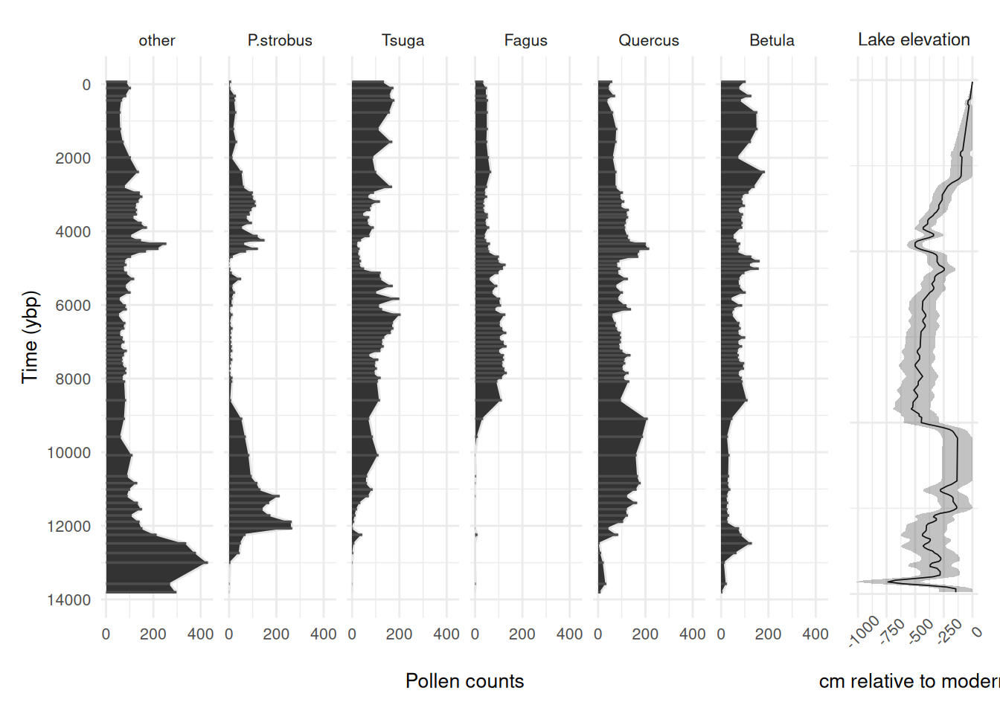

# Sunfish pond example

## Introduction

This vignette will show you how to fit the model at multiple binning
resolutions using Sunfish Pond (Pennsylvania) as an example dataset
(Johnson et al., in review). It is recommended to look at the
[multinomialTS
Vignette](https://quinnasena.github.io/multinomialTS/articles/multinomialTS-vignette.md)
before tackling this one! The [multinomialTS
Vignette](https://quinnasena.github.io/multinomialTS/articles/multinomialTS-vignette.md)
takes you through the fitting process, and bootstrapping, of
*multinomialTS*. In this vignette we will go straight into fitting
multiple bin widths to assess the sensitivity of the results to the
binning resolution.

In this example, the data include a ~13,800-year long fossil pollen
record, and a lake level reconstruction used as a proxy for
hydroclimatic variability and plant water availability. There are 69
pollen observations over the ~13,800-year long period that are unevenly
spaced through time (see the plot below), and lake level has a regular
50-year observation resolution.

### Why is bin width important?

Consider the bin width a prediction resolution, it would be unrealistic
to make annual predictions over a ~13,800-year long period from 69
observations (this is nice and intuitive), we can only make inference
given the information in the data. For example, we may be able to make
reasonable predictions at a centennial scale. The larger the bins the
less the model will capture processes occurring at a finer temporal
scale. For example, if your prediction resolution is 300-years, you
might be losing early successional processes occurring at a 100-year
scale. Additionally, observations of the covariates that fall within the
same bin are averaged; thus, having a smoothing effect on the
covariates, which may be undesirable. So, we aim for a bin width as
small as reasonably possible in order to minimise the aggregation of
data that fall within a single bin.

## Data processing

Before fitting a `multinomialTS` model, the raw data need to be shaped
into two matrices:

- **$`Y`$**: a site-by-species (time-by-taxon) matrix of counts for the
  focal taxa, with a reference taxon in the first column.
- **$`X`$**: a matrix of environmental covariates, aligned to the same
  temporal resolution as $`Y`$.

Because the lake level reconstruction is built from short cores, and the
pollen is from a separate lake core, they do not share a chronology. We
won’t be tackling any issues of aligning chronologies here! For the sake
of this demonstration, we will be binning the data so that observations
fall within the nearest time bin.

``` r

library(ggplot2)
library(dplyr)
library(tidyr)
library(stringr)
library(scales)
library(multinomialTS)
library(patchwork)
library(future.apply)
library(furrr)
library(purrr)
library(forcats)
library(ggtext)
```

First let’s see what the data look like:

Code

``` r

sunfish_pollen_long <- sunfish_pollen_wide |>
  pivot_longer(-age) |>
  mutate(name = factor(name, levels = c(
    "other", "P.strobus", "Tsuga", "Fagus", "Quercus", "Betula"))) |>
  arrange(age)

pol_plot <- ggplot(sunfish_pollen_long, aes(x = age, y = value)) +
    geom_area(colour = "grey90") +
    geom_segment(data = sunfish_pollen_long,
      aes(x = age, xend = age,
      y = 0, yend = value), colour = "grey30", linewidth = 0.6) +
    scale_y_continuous(breaks = scales::breaks_pretty(n = 3)) +
    scale_x_reverse(breaks = scales::breaks_pretty(n = 6)) +
    coord_flip() +
    labs(y = "Pollen counts", x = "Time (ybp)") +
    facet_wrap(~name,
               nrow = 1) +
    theme_minimal() +
    theme(
      text = element_text(size = 10)
    )

ll_plot <- sunfish_ll |>
  mutate(panel = "Lake elevation") |>  # fake facet variable
  ggplot(aes(x = age, y = lake_lvl,
             ymin = LowerBound, ymax = UpperBound)) +
  geom_line(linewidth = 0.3) +
  geom_ribbon(alpha = 0.3) +
  coord_flip() +
  scale_x_reverse() +
  labs(x = NULL, y = "cm relative to modern") +
  theme_minimal() +
  theme(
    axis.text.x = element_text(angle = 45),
    text = element_text(size = 10),
    strip.text = element_text(size = 9),
    axis.text.y = element_blank()
  ) +
  facet_wrap(~panel)
  
pol_plot + ll_plot + plot_layout(widths = c(0.85, 0.15))
```



Pollen counts of five key species in the Sunfish Pond record alongside
the lake level reconstruction. All other species are grouped in the
‘other’ species group

We can see some patterns in the driver and species responses. See the
[multinomialTS
Vignette](https://quinnasena.github.io/multinomialTS/articles/multinomialTS-vignette.md)
for how to fit such data in multiple ways to test hypotheses. Here, we
will just be using the one model fit (with no species interactions) to
demonstrate fitting multiple bin widths.

## Prediction resolution sensitivity

Now we are going to fit the data to multiple bin widths. We are going to
use the case with no species interactions included in the $`C`$ matrix.
To avoid generating too much data for the online vignette, I have used
only two bin widths (75 and 150 years), but see the commented-out code
to loop over a sequence (`bin_width <- seq(50, 150, 25)`). The following
code loops over the sequence of bin widths and:

- chunks the data into bin widths equal to the number of years (e.g., 50
  and 75 year bins)
- sums all pollen observations in each bin so that if more than one
  observation falls within the same bin they are summed together
- Averages observations of the covariate (lake level) that fall within
  the same bin
- outputs a list (one element per bin width) of $`X`$ and $`Y`$ matrices

``` r

# Create some bins
# bin_width <- seq(50, 150, 25)

bin_width <- c(75, 150)

bin_sensitivity_data <- lapply(bin_width, \(bw) {

  # Assign each pollen observation to a time bin of width `bw`
  sunfish_bins <-
    cut(
      sunfish_pollen_wide$age,
      breaks = seq(
        from = min(sunfish_pollen_wide$age),
        to = max(sunfish_pollen_wide$age) + bw,
        by = bw
      ), include.lowest = TRUE, labels = FALSE)

  # Sum pollen counts within each bin; take mean age as the bin's representative age
  sunfish_spp_binned <- bind_cols(bins = sunfish_bins, sunfish_pollen_wide) |>
    group_by(bins) |>
    summarise(across(c("other", "P.strobus", "Tsuga", "Fagus", "Quercus", "Betula"), \(x) sum(x ,na.rm = TRUE)),
              age = mean(age, na.rm = TRUE)) |>
    arrange(desc(age))

  # Assign each lake level observation to the same bin grid as the pollen data
  ll_bins <-
    cut(
      sunfish_ll$age,
      breaks = seq(
        from = min(sunfish_pollen_wide$age),
        to = max(sunfish_pollen_wide$age) + bw,
        by = bw
      ), include.lowest = TRUE, labels = FALSE)

  # Average lake level within each bin; drop bins outside the pollen age range
  ll_mean <- cbind(bins = ll_bins, sunfish_ll) |>
    drop_na(bins) |>
    select(bins, lake_lvl) |>
    group_by(bins) |>
    summarise(mean_ll = mean(lake_lvl)) |>
    arrange(desc(bins))

  # Join pollen and lake level by shared bin index
  sunfish_all <- sunfish_spp_binned |>
    full_join(ll_mean, by = "bins") |>
    arrange(desc(bins))

  # Diagnostic: identify which bins lack a lake-level observation
  which(is.na(sunfish_all$mean_ll))

  # Fill the missing lake-level bin using linear interpolation
  sunfish_all_interp <- sunfish_all |>
    mutate(across(c(mean_ll), forecast::na.interp))

  Y <- sunfish_all_interp |>
    select(other, P.strobus, Tsuga, Fagus, Quercus, Betula) |>
    as.matrix()

  # set up X
  X <- sunfish_all_interp |>
    select(mean_ll) |>
    as.matrix() |>
    scale() # scale covariates; important when using multiple X variables with different units

  return(list(Y = Y,
              X = X))

})

names(bin_sensitivity_data) <- paste0("bw_", bin_width)
```

Let’s check the output to see how many observations in $`Y`$ were
aggregated.

``` r

sum(complete.cases(bin_sensitivity_data$bw_75$Y))
sum(complete.cases(bin_sensitivity_data$bw_150$Y))
```

At a bin width of 75-years 69 remain (all original observations are in
independent bins, this is good). At a bin width of 150-years 63 remain.
Looks like 6 observations have been aggregated in bins.

We want to find out if different binning resolutions have a notable
effect on the model results. Below, I use the `future.apply` package to
run *multinomialTS* in parallel over the bin widths to save some time!

> **Tip**
>
> Note: this could take a while! If you are running the code as we go,
> you may not want to run the rest of the vignette.

``` r

plan(multisession, workers = length(bin_sensitivity_data))
bin_sensitivity_res <- future_lapply(bin_sensitivity_data, \(x) {

  Y <- x$Y
  X <- x$X

  # Dimensions: p = number of covariates + intercept, n = number of taxa
  p <- ncol(X) + 1
  n <- ncol(Y)
  # Row indices of non-empty time bins (bins with at least one pollen count)
  Tsample <- which(rowSums(Y) != 0)

  # Fix process variance to identity for the GLMM initialisation step
  V.fixed = diag(n)

  # Fix reference taxon (column 1) B coefficients to 0; estimate all others
  B.fixed <- matrix(c(rep(0,p),rep(NA, (n - 1) * p)), p, n)
  B.start <- matrix(c(rep(0,p),rep(.01, (n - 1) * p)), p, n)

  # Fit the GLMM to get starting values for the full mnTS model
  glmm_mod <- multinomialTS::mnGLMM(Y = Y[which(rowSums(Y) != 0),],
                                    X = X[which(rowSums(Y) != 0), , drop = FALSE],
                                    B.start = B.start, B.fixed = B.fixed,
                                    V.fixed = V.fixed)

  # Use GLMM estimates as starting values for mnTS
  B0.start <- glmm_mod$B[1, , drop = FALSE]
  B.start <- glmm_mod$B[2:p, , drop = FALSE]

  sigma.start <- glmm_mod$sigma

  # Allow all V elements to be estimated except V[1,1], which is fixed to 1
  # to impose identifiability on the reference taxon variance
  V.fixed = matrix(NA, n, n)
  V.fixed[1] = 1

  V.start <- glmm_mod$V

  # Fix reference taxon (column 1) B coefficients to 0; estimate all others
  B.fixed <- matrix(NA, ncol(X), n)
  B.fixed[,1] <- 0
  # Fix reference taxon intercept to 0
  B0.fixed = matrix(c(0, rep(NA, n - 1)), nrow = 1, ncol = n)

  # Diagonal-only C matrix: community dynamics with no between-taxon interactions
  C.start.diag = .5 * diag(n)
  C.fixed.diag <- C.start.diag
  C.fixed.diag[C.fixed.diag != 0] <- NA  # NA = estimate; 0 = fixed at zero (off-diagonals)

  # Model with no interactions
  start_time <- Sys.time()
  mnTS_mod <- mnTS(Y = Y[which(rowSums(Y) != 0),],
                   X = X, Tsample = Tsample,
                   B0.start = B0.start, B0.fixed = B0.fixed,
                   B.start = B.start, B.fixed = B.fixed,
                   C.start = C.start.diag, C.fixed = C.fixed.diag,
                   V.start = V.start, V.fixed = V.fixed,
                   dispersion.fixed = 1, maxit.optim = 1e+8)

  end_time <- Sys.time()
  end_time - start_time
  return(mnTS_mod)
})

# Save the results!
# saveRDS(bin_sensitivity_res, "...")
```

It’s always good idea to save the model outputs as they can take a while
to run. Now that we have our model fits, let’s bootstrap them. You will
want to do more than the 20 bootstraps as in the demonstration below
(data examples have to be small for vignettes). We recommend doing as
many bootstraps as processing power will allow for, since the fitting
time changes per data set it is tricky to provide any rule of thumb. One
method is to fit 10-100 bootstraps using
[`Sys.time()`](https://rdrr.io/r/base/Sys.time.html) to time the
process, then use the result to guide your bootstrapping. We are going
to do the bootstrapping in parallel too:

``` r

plan(multisession, workers = length(bin_sensitivity_res))
bootstrap_sensitivity <- furrr::future_map(
  bin_sensitivity_res, multinomialTS::bootstrap, reps = 20,
  .options = furrr_options(seed = 1984))

# saveRDS(bootstrap_sensitivity, "...")
```

Now we have our models bootstrapped, we can plot the output coefficients
for the different binning resolutions. While the output provides useful
tables of results, these tables need some wrangling before they plot
nicely in `ggplot2`. In this example we pull out the $`B`$ coefficients
from the bootstrap output and visualise them per bin resolution. The
process is similar for the $`C`$ coefficients. Currently, this is a bit
of a manual slog, not very user-friendly, and we will be updating the
package to include helper functions. For now, bear with us :)

> **Note**
>
> The remaining code in this vignette is shown but **not run**, because
> bootstrap output depends on the model version that produced it and so
> is not bundled with the package. Run the two chunks above on your own
> data (saving the results with
> [`saveRDS()`](https://rdrr.io/r/base/readRDS.html), as commented), and
> the code below will then work against your `bootstrap_sensitivity`
> object.

``` r

# Named vector mapping model column names to human-readable labels for plot axes
X_names_list <- c(
  mean_ll ="Lake level"
)

# Reshape bootstrapped coefficient table to long format, one row per bootstrap replicate per coefficient
mods_boot <- map(bootstrap_sensitivity, ~ {
  as_tibble(.x[[2]]) |>
    pivot_longer(-c(logLik, opt.convergence))
}) |>
  bind_rows(.id = "mod")

# Compute per-coefficient summary statistics across bootstrap replicates.
# The output already includes standard deviations, but recalculating here is
# necessary because each parallel instance needs to be combined and this method
# lets you choose custom quantile bounds (here: 68% credible interval ≈ ±1 SD).
mods_boot_68 <- mods_boot |>
  group_by(mod, name) |>
  summarise(boot_mean = mean(value),
            boot_sd = sd(value),
            upper_68 = quantile(value, probs = 0.84),
            lower_68 = quantile(value, probs = 0.16)) |>
  mutate(t_scores = boot_mean / boot_sd,
         p_vals = 2 * pnorm(q = abs(t_scores), lower.tail = FALSE),
         sig = p_vals < 0.05)

# Map internal y1-y6 column names back to taxon names.
# Order must match the column order in the original Y matrix.
mods_boot_68_B <- mods_boot_68 |>
  filter(grepl(paste(names(X_names_list), collapse = "|"), name)) |>
  separate_wider_delim(cols = name, delim = ".", names = c("cov", "name")) |>
  mutate(name = str_replace_all(name,
                                pattern = "y2|y3|y4|y5|y6",
                                replacement = function(x) case_when(
                                  x == "y2" ~ "_P.strobus_",
                                  x == "y3" ~ "_Tsuga_",
                                  x == "y4" ~ "_Fagus_",
                                  x == "y5" ~ "_Quercus_",
                                  x == "y6" ~ "_Betula_",
                                  TRUE ~ x)),
         mod = fct(mod, levels = names(bootstrap_sensitivity)))

bin_labs <- names(bootstrap_sensitivity)
names(bin_labs) <- levels(mods_boot_68_B$mod)
```

Now that we have everything wrangled and re-named, let’s make some
visualisations to compare the different binning resolutions.

``` r

mod_plots_B <- mods_boot_68_B |>
  mutate(panel = "Lake level effect") |>
  ggplot(aes(x = name, y = boot_mean)) +
  geom_point() +
  geom_hline(yintercept = 0, linetype = "dashed", alpha = 0.2) +
  geom_errorbar(aes(ymin = lower_68, ymax = upper_68),
                width = .2, alpha = 0.5) +
  facet_wrap(~mod, labeller = labeller(mod = bin_labs)) +
  labs(x = "Taxa", y = "Coefficient of lake level effect") +
  theme_bw() +
  theme(
    axis.text = element_markdown(size = 10, angle = 45, hjust = 1),
    axis.title = element_text(size = 10),
    strip.background = element_rect(fill = NA),
    legend.position = "inside",
    legend.position.inside = c(.11, .91),
    legend.text = element_text(size = 8),
    legend.title = element_text(size = 8),
    legend.background = element_rect(fill = NA)
  )

mod_plots_B
```

### Reading the result

When we ran this on the Sunfish Pond data, the $`B`$ coefficients
changed little between 75- and 150-year bins, which is reassuring — it
means the inferences are not an artefact of the prediction resolution.
Combined with the fact that 75-year bins keep all 69 observations in
independent bins, and that the model converged without trouble at that
resolution, there was a reasonable case for going with 75-year bins.
